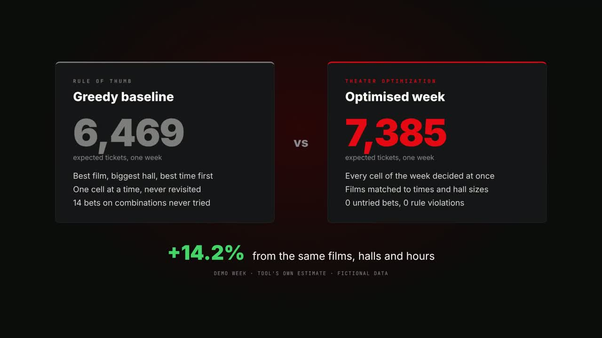

# Theater Optimization

Decision support for the weekly cinema schedule: which film plays in which hall at what time.
The tool learns demand from purchase records and drafts next week for one venue, with reasons per cell.
It runs **entirely offline**: open `demo.html` in any desktop browser, with no server, install, account or network.

[](media/walkthrough.mp4)

**[Watch the 2.5-minute walkthrough](media/walkthrough.mp4)**

> Titles, venue, halls and purchases are invented.
> Figures illustrate the mechanism, not a forecast.

## Deliverables

| File | What it is |
|---|---|
| `demo.html` | Interactive planner: settings, records, demand estimate, baseline vs optimised plan, cinema simulation, test cases |
| `proposal.html` | 12-slide proposal deck for a fictional cinema operator |
| `problem-definition.md` | Problem definition in the course's seven-section template |

## Offline by design

- Each HTML file is self-contained: scripts are inlined and formulas are pre-rendered at build time, so nothing loads from a CDN.
- No data leaves the machine; the purchase history is generated in the browser.
- The build fails if a file references any external resource.
- All browser checks run with the network disabled.

## Scope

We use demand estimated from purchase records, hall seats and the confirmed film list, before next week's schedule is published, to decide which film plays in which hall at each show time, in order to increase expected admissions without breaking show commitments.

- **Must have:** one venue, one week, booked films; one film per hall-time; min / max shows per film; runtime plus cleaning fits the slot; advisory only, side by side with a baseline.
- **Should have:** caution on untried combinations, an optimality certificate, reasons and runner-up per cell, clear messages when rules cannot be met.
- **Won't have now:** film booking, pricing, several venues, mid-week changes, external demand signals (social media, weather, holidays).

## Method

1. **Screenings:** sum purchases per film, date and time; a total equal to a hall's seats is flagged as sold out.
2. **Pattern:** film strength x time of day x weekday, fitted by maximum likelihood.
3. **Bayes update:** per film, time and day type, the pattern is the prior and the cell's own screenings are the evidence.
4. **Value:** expected tickets per hall under a negative-binomial predictive, with caution on combinations never tried.
5. **Weekly LP:** the best week under the rules, certified optimal by duality and compared with a greedy rule of thumb.

## Results (fictional demo week)

| | Greedy baseline | Optimised |
|---|---|---|
| Expected tickets | 6,469 | 7,385 (+14.2%) |
| Untried combinations used | 14 | 0 |
| Rule violations | 0 | 0 |

The plan is optimal for the stated model (planning value 6,552.2 = dual bound).
It beats the baseline on hidden demand in 289 of 300 random configurations.
Any effect on real admissions is not established yet.
The proposal asks for a data audit and an offline replay at one venue, then a randomised advisory trial.

## Build and verify

```sh
cd src && npm install             # KaTeX, build time only
node --test                       # engine tests
node build.cjs                    # writes ../demo.html and ../proposal.html
cd .. && python tools/verify.py   # offline browser checks (Playwright + Chromium)
```

`src/tune.cjs`, `src/study.cjs` and `src/sweep.cjs` regenerate the tuning, mock study and robustness sweep used by the build.

## Video

The walkthrough is a [Remotion](https://www.remotion.dev/) project in `video/`, built from real captures of the two HTML files.

```sh
python video/scripts/capture.py   # offline captures into video/public
cd video && npm install
npx remotion render src/Root.tsx MainVideo out/walkthrough.mp4
```
